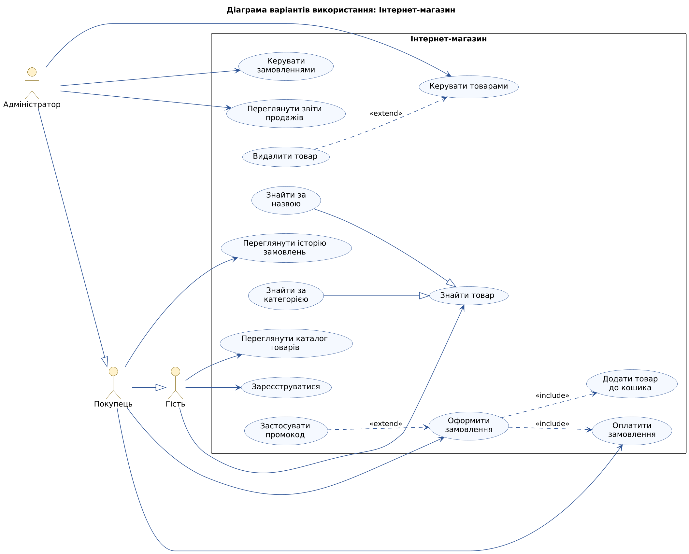
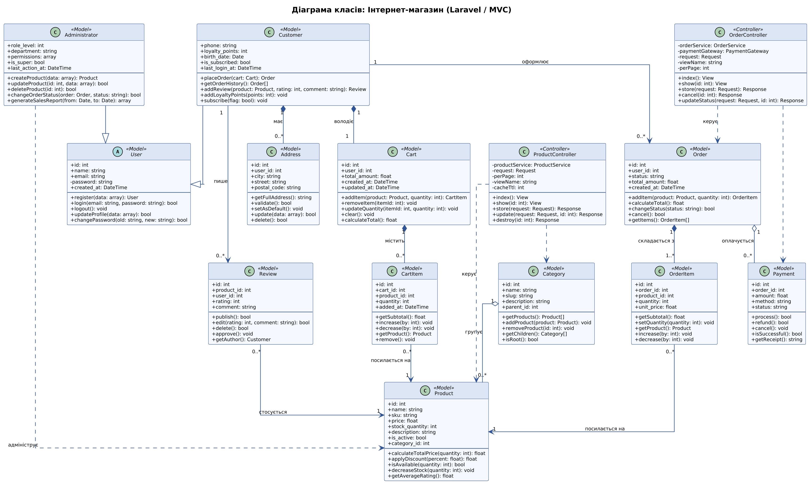

# Архітектура системи «Інтернет-магазин»

## 1. Предметна галузь та характеристики системи

**Призначення.** Веб-додаток для продажу товарів через мережу Інтернет на базі PHP/Laravel: покупець переглядає каталог, формує кошик, оформлює та оплачує замовлення; адміністратор керує асортиментом і замовленнями та аналізує продажі.

**Основні функції:**

1. Перегляд каталогу товарів із пагінацією та фільтрацією за категорією.
2. Пошук товарів за назвою та категорією.
3. Реєстрація й авторизація користувачів.
4. Робота з кошиком (додавання, зміна кількості, видалення позицій).
5. Оформлення та оплата замовлення (картка, готівка при отриманні).
6. Перегляд історії замовлень і статусу доставки.
7. Керування товарами та категоріями (CRUD) адміністратором.
8. Керування статусами замовлень та формування звітів продажів.

**Користувачі системи:** Гість, Покупець, Адміністратор.

**Архітектура:** MVC (Laravel) — Eloquent-моделі, контролери, Blade-представлення; бізнес-логіка винесена у сервісний шар.

**Основні сутності / таблиці БД:** `users`, `addresses`, `categories`, `products`, `reviews`, `carts`, `cart_items`, `orders`, `order_items`, `payments`.

**Вихідні дані:** каталог товарів (таблиця із залишками), чек/підсумок замовлення, звіт про продажі за період, графік динаміки продажів.

## 2. Use Case у повній формі: «Оформити замовлення»

| Розділ | Опис |
|---|---|
| **Use Case Name** | Оформити замовлення |
| **Scope** | Система «Інтернет-магазин» (System) |
| **Level** | User-goal |
| **Primary Actor** | Покупець |
| **Stakeholders and interests** | Покупець — швидко та без помилок оформити замовлення і бачити остаточну суму; Магазин — коректно зафіксувати замовлення та оплату; Адміністратор — отримати повні дані для комплектації та доставки; Платіжна система — отримати коректний запит на списання; Податкова — облік кожного продажу. |
| **Preconditions** | Покупець авторизований; у кошику є щонайменше один товар. |
| **Success guarantee** | Замовлення збережено зі статусом «Оплачено» (або «Очікує оплати» при післяплаті); залишки товарів зменшено; кошик очищено; покупець отримав підтвердження на e-mail. |

**Main Success Scenario:**

1. Покупець відкриває кошик і натискає «Оформити замовлення».
2. Система перевіряє наявність кожного товару на складі та актуальність цін.
3. Система відображає форму оформлення з підсумком кошика.
4. Покупець обирає збережену адресу доставки (або вводить нову).
5. Покупець обирає спосіб доставки.
6. Покупець обирає спосіб оплати.
7. Система розраховує загальну суму (товари + доставка − знижки).
8. Покупець перевіряє дані та підтверджує замовлення.
9. Система створює замовлення (`orders`, `order_items`) зі статусом «Нове».
10. Система передає запит на оплату платіжному шлюзу.
11. Платіжний шлюз підтверджує оплату; система змінює статус на «Оплачено».
12. Система зменшує залишки товарів і очищає кошик.
13. Система надсилає покупцю e-mail із підтвердженням і номером замовлення.
14. Система відображає сторінку «Дякуємо за замовлення».

**Extensions:**

- **2a.** Товару немає в наявності в потрібній кількості: система повідомляє покупця, пропонує зменшити кількість або видалити позицію; повернення до кроку 1.
- **2b.** Ціна товару змінилась: система оновлює ціну в кошику, показує повідомлення; сценарій продовжується з кроку 3.
- **4a.** У покупця немає збережених адрес: система відображає форму нової адреси; після валідації та збереження — крок 5.
- **4b.** Адресу введено некоректно: система підсвічує помилкові поля; повернення до кроку 4.
- **7a.** Покупець має промокод: вводить код, система перевіряє його й перераховує суму (use case «Застосувати промокод»); якщо код недійсний — повідомлення про помилку.
- **10a.** Платіжний шлюз відхилив оплату (недостатньо коштів / помилка картки): система зберігає замовлення зі статусом «Очікує оплати», пропонує інший спосіб оплати або повтор; якщо покупець відмовляється — замовлення скасовується.
- **10b.** Платіжний шлюз недоступний (таймаут): система повідомляє про технічну проблему, логує помилку, зберігає замовлення зі статусом «Очікує оплати».
- **\*a.** У будь-який момент покупець закриває сторінку: кошик зберігається, замовлення не створюється.

**Special Requirements:** відповідь шлюзу оплати ≤ 30 с у 90 % випадків; адаптивний інтерфейс (мобільні пристрої); дані картки не зберігаються в системі (PCI DSS); підтримка української та англійської мов.

**Technology and Data Variations List:** оплата — банківською карткою (Visa/Mastercard), Apple Pay/Google Pay або готівкою при отриманні; доставка — кур'єр, відділення пошти, самовивіз; підтвердження — e-mail або SMS.

**Frequency of Occurrence:** ≈ 30 % сесій авторизованого покупця.

**Miscellaneous:** уточнити політику повернення коштів; чи потрібна оплата частинами; чи дозволяти оформлення без реєстрації.

## 3. Діаграма варіантів використання

Актори: **Гість**, **Покупець** (узагальнення Гостя), **Адміністратор** (узагальнення Покупця). Використано всі види зв'язків: асоціація, узагальнення (акторів і варіантів використання), `include`, `extend`.

Вихідний код: [`use-case-diagram.puml`](use-case-diagram.puml)

## 4. Діаграма класів

Діаграма містить 14 класів (12 моделей Eloquent та 2 контролери). Використано всі типи відношень: асоціація, агрегація, композиція, наслідування.

Вихідний код: [`class-diagram.puml`](class-diagram.puml)

### Відповідність класів моделям Laravel та таблицям БД

| Клас (UML) | Eloquent-модель | Таблиця БД |
|---|---|---|
| User / Customer / Administrator | `App\Models\User` (поле `role`) | `users` |
| Address | `App\Models\Address` | `addresses` |
| Category | `App\Models\Category` | `categories` |
| Product | `App\Models\Product` | `products` |
| Review | `App\Models\Review` | `reviews` |
| Cart / CartItem | `App\Models\Cart`, `App\Models\CartItem` | `carts`, `cart_items` |
| Order / OrderItem | `App\Models\Order`, `App\Models\OrderItem` | `orders`, `order_items` |
| Payment | `App\Models\Payment` | `payments` |
| ProductController, OrderController | `App\Http\Controllers\*` | — |

Зв'язки реалізуються методами ORM: композиція/агрегація — `hasMany()` / `belongsTo()`; наслідування користувачів — через поле `role` (single-table inheritance).
